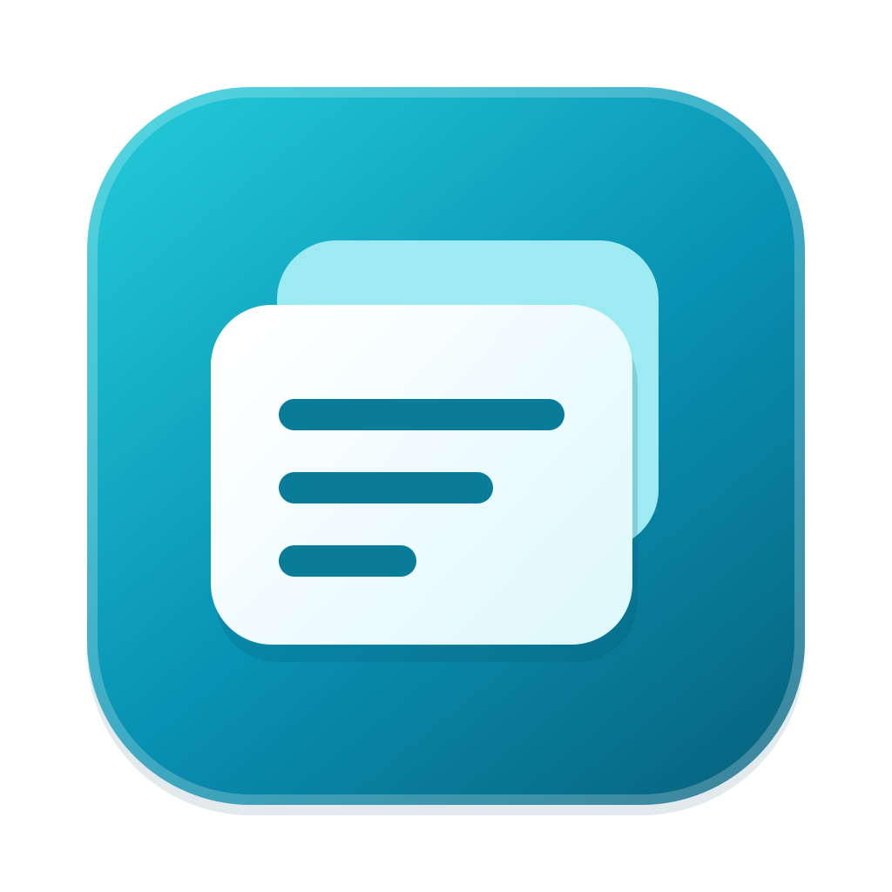

# Snippets

Menu bar app for macOS. Press Hyper (caps lock via Karabiner, ⌃⌥⇧⌘) + any key to paste a saved snippet into the focused field. A key with several snippets shows a numbered picker. Your clipboard is restored afterwards.

- Plain text, rich text and images
- Click the menu bar icon to copy any snippet by hand
- Settings → keys on the left, snippets on the right
- Data lives locally in `~/Library/Application Support/Snippets/snippets.json`

## Build

```sh
xcodegen generate
xcodebuild -project Snippets.xcodeproj -scheme Snippets -destination 'platform=macOS' build test
```

Pasting needs Accessibility permission (prompted on first use).

## Install

Requires macOS 26 or later (Apple silicon or Intel).

1. [Download Snippets.dmg](https://github.com/EdmundLimBoEn/snippets/releases/latest/download/Snippets.dmg).
2. Open the DMG and drag Snippets into Applications, then launch it there.
3. Grant Snippets permission in System Settings → Privacy & Security → Accessibility when prompted.

The demo release is signed with Developer ID; Apple notarization is still pending. If macOS blocks the first launch, use System Settings → Privacy & Security → **Open Anyway**, or run `xattr -dr com.apple.quarantine /Applications/Snippets.app`.

Snippets checks for updates automatically using Sparkle. You can also choose **Check for Updates…** from the menu bar menu.

## Releases

Every push to `main` runs the Release workflow, tests the app, and publishes a universal signed DMG plus a signed Sparkle update. Releases use Apple Development signing without notarization until Developer ID secrets are configured, then switch automatically to Developer ID signing and notarization. Versions are `1.0.<GitHub run number>` with increasing build numbers. The download and update feed always use the latest GitHub Release. Signing setup and recovery instructions are in [docs/releases.md](docs/releases.md).

Written by gpt-6-astra in Codex on behalf of Edmund
